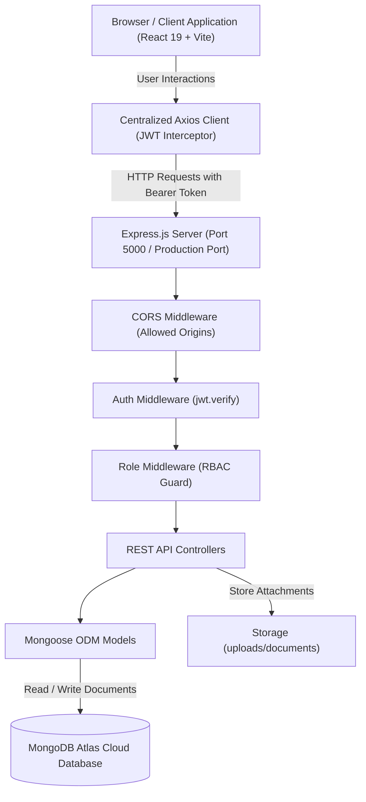
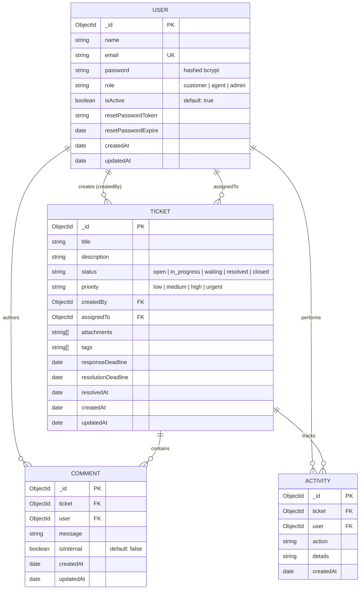

# DeskFlow — IT Helpdesk & Support Ticket Management System

[](https://react.dev/)
[](https://vitejs.dev/)
[](https://nodejs.org/)
[](https://www.mongodb.com/)
[](https://vercel.com/)
[](https://render.com/)
[](LICENSE)

An enterprise-grade, full-stack **IT Helpdesk and Support Ticket Management System** designed and developed with modern MERN architecture. The system features a responsive React dashboard, robust Node.js/Express REST APIs, MongoDB Atlas database integration, role-based access control (RBAC), multi-role workflows, public customer replies, confidential internal staff notes, file attachments, SLA tracking, and complete activity audit logging.

---

## 🌐 Live Deployments & Demos

| Service | Environment | URL | Status |
| :--- | :--- | :--- | :--- |
| **Frontend Application** | Production (Vercel) | [https://helpdesk-ticketing-system-frontend.vercel.app](https://helpdesk-ticketing-system-frontend.vercel.app) *(or your deployed Vercel domain)* | `Live` |
| **Backend REST API** | Production (Render) | [https://helpdesk-ticketing-system-api.onrender.com](https://helpdesk-ticketing-system-api.onrender.com) *(or your deployed Render service)* | `Live` |
| **Interactive API Docs** | Swagger OpenAPI 3.0 | `https://<your-render-url>/api-docs` | `Live` |
| **API Health Check** | Monitoring Endpoint | `https://<your-render-url>/api/health` | `200 OK` |

---

## 📑 Table of Contents

1. [Project Overview & Main Features](#1-project-overview--main-features)
2. [Technology Stack](#2-technology-stack)
3. [System Architecture](#3-system-architecture)
4. [Database Schema & ER Diagram](#4-database-schema--er-diagram)
5. [Role-Based Access Control (RBAC) Matrix](#5-role-based-access-control-rbac-matrix)
6. [Project Directory Structure](#6-project-directory-structure)
7. [Environment Variables Guide](#7-environment-variables-guide)
8. [Local Development Setup](#8-local-development-setup)
9. [Pre-Configured Demo Accounts](#9-pre-configured-demo-accounts)
10. [REST API Endpoints](#10-rest-api-endpoints)
11. [Production Deployment Guide (Vercel + Render + MongoDB Atlas)](#11-production-deployment-guide)
12. [Testing & Verification](#12-testing--verification)
13. [Screenshots Section](#13-screenshots-section)
14. [Viva Voce Technical Q&A](#14-viva-voce-technical-qa)

---

## 1. Project Overview & Main Features

### Problem Statement
In modern organizational IT departments, tracking user requests, equipment incidents, software glitches, and access issues via emails or spreadsheets leads to lost tickets, lack of accountability, missed Service Level Agreements (SLAs), and non-existent audit trails. 

### Proposed Solution: DeskFlow
DeskFlow provides a centralized helpdesk portal with strict separation of privileges and automated lifecycle management:

- **Customer / Requester Portal**:
  - Submit tickets with priority classification (`low`, `medium`, `high`, `urgent`) and custom tags.
  - Upload file attachments and error logs (`multipart/form-data`).
  - View scoped ticket queues (customers only access their own submissions).
  - Participate in bidirectional public ticket discussion threads.
  - Real-time resolution notifications and status updates.

- **Support Agent Workspace**:
  - Global ticket triage queue with priority-based color coding.
  - One-click ticket status transitions (`open` &rarr; `in_progress` &rarr; `waiting` &rarr; `resolved` &rarr; `closed`).
  - Add confidential internal staff notes (automatically hidden from customers).
  - Track response and resolution deadlines against SLA target metrics.
  - Upload diagnostics, patches, and logs directly to tickets.

- **Administrator Command Center**:
  - Comprehensive KPI dashboard (Total, Open, In Progress, Waiting, Resolved, Closed, Priority breakdown).
  - Explicit agent assignment and re-assignment workflows with automated email notifications.
  - Complete User Directory Management (Add users, change roles, deactivate accounts).
  - Immutable activity audit logging on all tickets (creation, assignment, status change, comments, files).
  - System performance, resolution velocity, and SLA compliance metrics.

---

## 2. Technology Stack

| Layer | Technology | Version | Purpose |
| :--- | :--- | :--- | :--- |
| **Frontend Framework** | React.js | `^19.2.8` | Component-driven UI and responsive single-page application |
| **Build Tooling** | Vite | `^8.3.4` | Lightning-fast development server, HMR, and production bundler |
| **Routing** | React Router DOM | `^7.18.4` | Client-side routing with nested protected layouts and guards |
| **HTTP Client** | Axios | `^1.20.0` | HTTP requests with Bearer JWT interceptors and error handling |
| **Icons** | Lucide React | `^1.57.0` | Modern, lightweight SVG iconography |
| **Styling** | Vanilla CSS3 Tokens | Custom | Design system with responsive layout, CSS variables, and dark/light accents |
| **Runtime** | Node.js (ESM) | `v18+ / v20+ / v22+` | Asynchronous JavaScript backend runtime |
| **Backend Framework** | Express.js | `^5.2.1` | REST API routing, controllers, and middleware pipeline |
| **Database** | MongoDB Atlas | Cloud Cluster | Cloud-hosted NoSQL document database |
| **ODM** | Mongoose | `^9.7.0` | Object data modeling, schema validation, and relational population |
| **Authentication** | JWT (`jsonwebtoken`) | `^9.0.3` | Stateless JSON Web Token authentication |
| **Password Security** | `bcryptjs` | `^3.0.3` | Salted password hashing (Cost factor 10) |
| **File Handling** | Multer | `^2.2.0` | Multipart file upload handling with disk storage |
| **Email Service** | Nodemailer | `^9.0.1` | Automated SMTP email delivery for assignments and password resets |
| **API Documentation** | Swagger UI Express | `^5.0.1` | OpenAPI 3.0 interactive documentation |
| **Hosting** | Vercel & Render | Cloud | Free-tier cloud hosting for Frontend (Vercel) and Backend (Render) |

---

## 3. System Architecture



---

## 4. Database Schema & ER Diagram



---

## 5. Role-Based Access Control (RBAC) Matrix

| Feature / Action | Endpoint | Customer | Agent | Admin |
| :--- | :--- | :---: | :---: | :---: |
| Register / Login | `POST /api/auth/register`, `login` |  Yes |  Yes |  Yes |
| View Profile | `GET /api/auth/me` |  Yes |  Yes |  Yes |
| Create Support Ticket | `POST /api/tickets` |  Yes |  Yes |  Yes |
| View Tickets List | `GET /api/tickets` |  Own Only |  All |  All |
| View Ticket Detail | `GET /api/tickets/:id` |  Own Only |  All |  All |
| Post Public Comment | `POST /api/comments` |  Yes |  Yes |  Yes |
| Post Internal Note | `POST /api/comments` (`isInternal: true`) | ❌ Forbidden |  Yes |  Yes |
| View Internal Notes | `GET /api/comments/:ticketId` | ❌ Filtered Out |  Yes |  Yes |
| Assign Ticket to Agent | `PATCH /api/tickets/:id/assign` | ❌ Forbidden | ❌ Forbidden |  Yes |
| Change Ticket Status | `PATCH /api/tickets/:id/status` | ❌ Forbidden |  Yes |  Yes |
| Upload File Attachment | `POST /api/files/attach` |  Yes |  Yes |  Yes |
| View Audit Trail | `GET /api/activities/:ticketId` |  Yes |  Yes |  Yes |
| View Dashboard Stats | `GET /api/dashboard/stats` |  Scoped |  Global |  Global |
| View User Directory | `GET /api/users` | ❌ Forbidden |  Agents Only |  All |
| Create User / Edit Role | `POST /api/users`, `PATCH /api/users/:id` | ❌ Forbidden | ❌ Forbidden |  Yes |
| Delete Ticket | `DELETE /api/tickets/:id` | ❌ Forbidden | ❌ Forbidden |  Yes |
| Delete User | `DELETE /api/users/:id` | ❌ Forbidden | ❌ Forbidden |  Yes |

---

## 6. Project Directory Structure

```text
helpdesk/
├── config/
│   ├── db.js                   # MongoDB Atlas connection with TLS resilience
│   └── swagger.js              # Swagger OpenAPI 3.0 specification
├── controllers/
│   ├── activityController.js   # Audit trail activity controller
│   ├── authController.js       # Register, login, me, reset password
│   ├── commentController.js    # Comments & internal notes controller
│   ├── dashboardController.js  # Role-scoped statistics & priority counters
│   ├── fileController.js       # Multer attachment handlers with normalized paths
│   ├── ticketController.js     # Ticket CRUD, search, filter, and assignment
│   └── userController.js       # Admin user directory & role management
├── frontend/                   # React 19 + Vite Application
│   ├── src/
│   │   ├── api/                # Centralized Axios API services
│   │   │   ├── axiosClient.js  # Base client with JWT interceptor
│   │   │   ├── authApi.js
│   │   │   ├── ticketApi.js
│   │   │   ├── commentApi.js
│   │   │   ├── activityApi.js
│   │   │   ├── dashboardApi.js
│   │   │   ├── fileApi.js
│   │   │   └── userApi.js
│   │   ├── components/
│   │   │   ├── common/         # StatusBadge, PriorityBadge, RoleBadge, Modal,
│   │   │   │                   # ConfirmDialog, StatCard, Pagination, LoadingSpinner
│   │   │   └── layout/         # AppLayout, Sidebar, Navbar, ProtectedRoute
│   │   ├── context/            # AuthContext, ToastContext
│   │   ├── pages/
│   │   │   ├── auth/           # LoginPage, RegisterPage, ForgotPasswordPage, ResetPasswordPage
│   │   │   ├── dashboard/      # DashboardPage
│   │   │   ├── tickets/        # TicketListPage, CreateTicketPage, TicketDetailPage
│   │   │   ├── users/          # UserManagementPage (Admin)
│   │   │   ├── reports/        # ReportsPage (SLA Analytics)
│   │   │   └── NotFoundPage.jsx
│   │   ├── App.jsx             # React Router route declarations
│   │   ├── index.css           # Custom CSS Design System
│   │   └── main.jsx
│   ├── .env.example            # Sample frontend environment config
│   ├── vercel.json             # Vercel SPA routing rewrites
│   ├── package.json
│   └── vite.config.js
├── middleware/
│   ├── authMiddleware.js       # JWT extraction and validation
│   ├── roleMiddleware.js       # Role-based access control middleware
│   └── uploadMiddleware.js     # Multer storage configuration with auto-folder creation
├── models/
│   ├── Activity.js             # Audit trail schema
│   ├── Comment.js              # Comment & internal note schema
│   ├── Ticket.js               # Ticket schema with status, priority, SLAs
│   └── User.js                 # User schema with roles & password hashes
├── routes/
│   ├── activityRoutes.js
│   ├── auth.js
│   ├── commentRoutes.js
│   ├── dashboardRoutes.js
│   ├── fileRoutes.js
│   ├── ticketRoutes.js
│   └── userRoutes.js
├── tests/
│   ├── e2e_full_test.js        # 14-step automated full-lifecycle test
│   └── test_assignment_feature.js # Admin assignment & RBAC test suite
├── uploads/
│   └── documents/              # Local disk storage for file attachments
├── utils/
│   ├── logActivity.js          # Reusable activity logger
│   └── sendEmail.js            # Nodemailer transport with non-blocking error handling
├── .env.example                # Backend environment configuration template
├── .gitignore                  # Git exclusions (protects all secrets and node_modules)
├── render.yaml                 # Render cloud deployment blueprint
├── package.json                # Root package configuration with scripts
└── server.js                   # Express application entrypoint with health & CORS
```

---

## 7. Environment Variables Guide

### Backend (`.env` in Root Directory)
Create a `.env` file at the root of the project:

```ini
# ==============================================================
# DeskFlow IT Helpdesk System — Backend Environment Variables
# ==============================================================

# Server Port and Environment
PORT=5000
NODE_ENV=production

# MongoDB Atlas Connection URI
MONGO_URI=mongodb+srv://<username>:<password>@<cluster>.mongodb.net/helpdesk?retryWrites=true&w=majority

# JWT Authentication Secret (Use a strong, random 32+ character string in production)
JWT_SECRET=your_super_secret_jwt_key_min_32_characters_long

# Allowed Frontend URL for CORS (e.g. your Vercel deployment URL)
CLIENT_URL=https://your-frontend-app.vercel.app

# Public API URL (for Swagger documentation)
BASE_URL=https://your-backend-app.onrender.com

# SMTP Email Configuration (Nodemailer for notifications & password resets)
EMAIL_USER=your_email@gmail.com
EMAIL_PASS=your_email_app_password
EMAIL_HOST=smtp.gmail.com
EMAIL_PORT=587
# EMAIL_SERVICE=gmail
# EMAIL_SECURE=false
```

### Frontend (`frontend/.env`)
Create a `.env` file inside `frontend/`:

```ini
# DeskFlow Frontend Environment Variables (Vite)
# For local development: http://localhost:5000
# For production: https://your-backend-app.onrender.com (without trailing slash)
VITE_API_BASE_URL=https://your-backend-app.onrender.com
```

---

## 8. Local Development Setup

### Prerequisites
- **Node.js** (v18.x, v20.x, or v22.x)
- **npm** (comes with Node.js)
- **Git**
- Active **MongoDB Atlas** cluster or local MongoDB instance

### Step 1: Clone the Repository
```powershell
git clone https://github.com/vijaychelumalla/helpdesk-ticketing-system.git
cd helpdesk-ticketing-system
```

### Step 2: Configure Environment Files
```powershell
# Copy backend env example
Copy-Item .env.example .env

# Copy frontend env example
Copy-Item frontend\.env.example frontend\.env
```
*Edit `.env` and fill in your MongoDB Atlas connection string and JWT secret.*

### Step 3: Install Dependencies
```powershell
# Install backend dependencies
npm install

# Install frontend dependencies
npm --prefix frontend install
```

### Step 4: Run the Backend Server
```powershell
# In terminal 1 (root directory):
npm run dev
# Or: npm start
```
*Expected output:*
```text
Server running on port 5000 [development]
MongoDB Connected: ac-rgjcozc-shard-00-02.wnfssgr.mongodb.net
```

### Step 5: Run the Frontend Application
```powershell
# In terminal 2:
npm run client
# Or: cd frontend; npm run dev
```
*Expected output:*
```text
  VITE v8.3.4  ready in 320 ms
  ➜  Local:   http://localhost:5173/
```

### Step 6: Access Application
- **Frontend App**: [http://localhost:5173](http://localhost:5173)
- **Backend API**: [http://localhost:5000](http://localhost:5000)
- **API Health Check**: [http://localhost:5000/api/health](http://localhost:5000/api/health)
- **Interactive Swagger Docs**: [http://localhost:5000/api-docs](http://localhost:5000/api-docs)

---

## 9. Pre-Configured Demo Accounts

The login screen features **1-Click Demo Account Quick Fill Buttons** for examiner evaluations:

| Role | Email | Password | Access Level |
| :--- | :--- | :--- | :--- |
| 👑 **Administrator** | `akhil@gmail.com` | `123456` | Full system access, all tickets, user management, SLA reports |
| 🎧 **Support Agent** | `agent@gmail.com` | `123456` | Claim/assign tickets, change status, internal notes, reports |
| 👤 **Customer 1** | `krish@gmail.com` | `123456` | Create tickets, view own tickets, post replies, attachments |
| 👤 **Customer 2** | `bharat@gmail.com`| `123456` | Scoped customer account |

---

## 10. REST API Endpoints

### Authentication (`/api/auth`)
| Method | Endpoint | Description | Access |
| :--- | :--- | :--- | :--- |
| `POST` | `/api/auth/register` | Register new user account | Public |
| `POST` | `/api/auth/login` | Authenticate and return JWT token | Public |
| `GET` | `/api/auth/me` | Fetch currently authenticated user profile | Authenticated |
| `POST` | `/api/auth/forgot-password` | Generate password reset token and send email | Public |
| `POST` | `/api/auth/reset-password/:token` | Reset password using one-time token | Public |

### Tickets (`/api/tickets`)
| Method | Endpoint | Description | Access |
| :--- | :--- | :--- | :--- |
| `GET` | `/api/tickets` | Query tickets (`status`, `priority`, `search`, `assignedTo`, `page`, `limit`) | Scoped by Role |
| `GET` | `/api/tickets/:id` | Get single ticket with populated creator and assignee | Scoped by Role |
| `POST` | `/api/tickets` | Create support ticket (`title`, `description`, `priority`, `tags`, `attachments`) | Authenticated |
| `PATCH` | `/api/tickets/:id/status` | Update resolution state (`status`) | Agent / Admin |
| `PATCH` | `/api/tickets/:id/assign` | Assign or reassign ticket to an agent (`agentId`) | Admin Only |
| `DELETE` | `/api/tickets/:id` | Permanently remove a ticket | Admin Only |

### Comments & Notes (`/api/comments`)
| Method | Endpoint | Description | Access |
| :--- | :--- | :--- | :--- |
| `POST` | `/api/comments` | Post reply or internal staff note (`ticketId`, `message`, `isInternal`) | Authenticated |
| `GET` | `/api/comments/:ticketId` | Fetch discussion thread (internal notes hidden from customers) | Authenticated |

### File Attachments (`/api/files`)
| Method | Endpoint | Description | Access |
| :--- | :--- | :--- | :--- |
| `POST` | `/api/files/upload` | Upload multipart file to disk storage | Authenticated |
| `POST` | `/api/files/attach` | Upload and link file directly to ticket | Authenticated |

### Dashboard Analytics (`/api/dashboard`)
| Method | Endpoint | Description | Access |
| :--- | :--- | :--- | :--- |
| `GET` | `/api/dashboard/stats` | KPI statistics, status breakdown, and priority metrics | Scoped by Role |

### Audit Trail (`/api/activities`)
| Method | Endpoint | Description | Access |
| :--- | :--- | :--- | :--- |
| `GET` | `/api/activities/:ticketId` | Chronological activity audit trail for a ticket | Authenticated |

### User Directory (`/api/users`)
| Method | Endpoint | Description | Access |
| :--- | :--- | :--- | :--- |
| `GET` | `/api/users` | List users with pagination and role filter | Agent (Read-only) / Admin |
| `POST` | `/api/users` | Admin creates user with specified role | Admin Only |
| `PATCH` | `/api/users/:id` | Admin updates user name, role, or active status | Admin Only |
| `DELETE` | `/api/users/:id` | Admin deletes user account | Admin Only |

### Health & Information
| Method | Endpoint | Description | Access |
| :--- | :--- | :--- | :--- |
| `GET` | `/` | API status and links | Public |
| `GET` | `/api/health` | Uptime and service health check | Public |
| `GET` | `/api-docs` | Interactive Swagger OpenAPI documentation | Public |

---

## 11. Production Deployment Guide

### Architecture Overview
- **Frontend**: Hosted on [Vercel](https://vercel.com/) (Fast static delivery with CDN and SPA rewrites).
- **Backend**: Hosted on [Render](https://render.com/) (Managed Node.js web service).
- **Database**: Cloud-hosted on [MongoDB Atlas](https://www.mongodb.com/cloud/atlas).

---

### Step 1: MongoDB Atlas Configuration
1. Log in to [MongoDB Atlas](https://cloud.mongodb.com/).
2. Under **Security** &rarr; **Database Access**, verify your database user has `readWriteAnyDatabase` privileges.
3. Under **Security** &rarr; **Network Access**, ensure IP `0.0.0.0/0` (Allow access from anywhere) is added so cloud providers (Render) can connect.
4. Copy your cluster connection string (e.g., `mongodb+srv://<user>:<password>@cluster0.mongodb.net/helpdesk?retryWrites=true&w=majority`).

---

### Step 2: Deploy Backend to Render
1. Sign in to [Render](https://render.com/) with your GitHub account.
2. Click **New +** &rarr; **Web Service**.
3. Select your GitHub repository: `helpdesk-ticketing-system`.
4. Configure service settings:
   - **Name**: `helpdesk-ticketing-system-api`
   - **Region**: Nearest to your users (e.g., Oregon, Frankfurt, Singapore)
   - **Branch**: `main`
   - **Root Directory**: Leave blank (root)
   - **Runtime**: `Node`
   - **Build Command**: `npm install`
   - **Start Command**: `node server.js`
   - **Plan**: `Free`
5. Under **Environment Variables**, add:
   | Key | Value |
   | :--- | :--- |
   | `NODE_ENV` | `production` |
   | `PORT` | `5000` |
   | `MONGO_URI` | *Your MongoDB Atlas connection URI* |
   | `JWT_SECRET` | *Your strong 32+ character JWT secret* |
   | `CLIENT_URL` | *Your Vercel URL (e.g. `https://helpdesk-frontend.vercel.app`)* |
   | `EMAIL_USER` | *Your email address* |
   | `EMAIL_PASS` | *Your email app password* |
   | `EMAIL_HOST` | `smtp.gmail.com` |
   | `EMAIL_PORT` | `587` |
6. Click **Create Web Service**.
7. Once deployed, note down your live Backend URL (e.g., `https://helpdesk-ticketing-system-api.onrender.com`).
8. Verify backend availability by visiting: `https://<your-render-url>/api/health`.

---

### Step 3: Deploy Frontend to Vercel
1. Sign in to [Vercel](https://vercel.com/) with your GitHub account.
2. Click **Add New...** &rarr; **Project**.
3. Select the `helpdesk-ticketing-system` repository.
4. In the Project Configuration:
   - **Framework Preset**: `Vite`
   - **Root Directory**: Click edit and select `frontend`
   - **Build Command**: `npm run build`
   - **Output Directory**: `dist`
5. Under **Environment Variables**, add:
   | Key | Value |
   | :--- | :--- |
   | `VITE_API_BASE_URL` | `https://helpdesk-ticketing-system-api.onrender.com` *(your actual Render backend URL without trailing slash)* |
6. Click **Deploy**.
7. Once deployment finishes, Vercel gives you your production URL (e.g., `https://helpdesk-frontend.vercel.app`).
8. Update Render's `CLIENT_URL` environment variable with your actual Vercel URL to allow CORS requests.

---

## 12. Testing & Verification

### Automated End-to-End Test Suite
Run the 14-step automated verification suite:
```powershell
npm test
```

### Agent Assignment & RBAC Test Suite
Run the assignment and permissions test suite:
```powershell
npm run test:assignment
```

### Verified Test Cases:
1. `TC01 - Registration`: Creates unique user account with bcrypt password hashing.
2. `TC02 - Customer Login`: Issues signed JWT token.
3. `TC03 - Ticket Creation`: Validates title, description, priority, and tags.
4. `TC04 - Discussion Reply`: Customer posts reply to ticket.
5. `TC05 - Agent Login`: Authenticates support staff.
6. `TC06 - Agent Assignment`: Admin assigns ticket to agent; updates database and sends notification.
7. `TC07 - Status Transition`: Changes ticket state from `open` to `in_progress`.
8. `TC08 - Internal Notes`: Agent posts private note with `isInternal: true`.
9. `TC09 - Privacy Isolation`: Confirms customer query strips internal note from response (`false`).
10. `TC10 - Ticket Resolution`: Agent resolves ticket; records `resolvedAt` timestamp.
11. `TC11 - Audit Trail`: Confirms all 6 actions are recorded chronologically in `activities`.
12. `TC12 - Admin Login`: Authorizes admin privileges.
13. `TC13 - Dashboard Metrics`: Confirms real ticket counts match database state.
14. `TC14 - Destructive Action`: Admin deletes test ticket cleanly.

---

## 13. Screenshots Section

| Screen | Description | Preview |
| :--- | :--- | :--- |
| **01. Authentication & Quick-Fill** | Modern login screen with role quick-fill buttons |  |
| **02. Admin Dashboard** | KPI metric cards, status distribution, and recent tickets | *Dashboard KPI View* |
| **03. Ticket Queue** | Filterable list with priority badges and search bar | *Ticket Queue View* |
| **04. Ticket Details & Discussion** | Dual public replies and highlighted amber internal staff notes | *Ticket Discussion View* |
| **05. Assignment & Audit Log** | Stakeholder assignment controls and chronological event timeline | *Activity Audit Trail* |
| **06. User Directory** | Full user management with role controls and status toggles | *Admin User Directory* |

---

## 14. Viva Voce Technical Q&A

### Q1: What architectural pattern does this application follow?
> **Answer**: DeskFlow follows a **3-Tier Client-Server Architecture** using the MERN stack. The presentation tier is built with React 19 and Vite; the application logic tier is handled by Node.js and Express REST APIs; and the persistence tier utilizes MongoDB Atlas with Mongoose ODM schemas.

### Q2: How does authentication and authorization work in your project?
> **Answer**: Authentication uses JSON Web Tokens (JWT). When a user enters credentials, `bcryptjs` verifies the salted hash. Upon successful verification, the backend signs a JWT containing the user's `id` and `role`. For subsequent requests, the frontend Axios client attaches this token in the `Authorization: Bearer <token>` header. The server's `authMiddleware` verifies the token signature, and `roleMiddleware` restricts endpoints based on user roles (`customer`, `agent`, `admin`).

### Q3: How do you enforce security so customers cannot see other people's tickets?
> **Answer**: We enforce security authoritatively on the backend. In `ticketController.js`, `getTickets` checks `req.user.role`. If the user is a `customer`, it automatically injects `{ createdBy: req.user.id }` into the query filter. In `getTicketById`, if a customer attempts to fetch a ticket whose `createdBy` does not match their user ID, the API rejects the request with HTTP `403 Forbidden`.

### Q4: How is the internal note feature implemented securely?
> **Answer**: In `Comment.js`, comments contain an `isInternal` boolean field. When adding a comment, `commentController.js` validates that customers cannot set `isInternal: true` (returning HTTP 403). When retrieving comments via `getCommentsByTicket`, if `req.user.role === 'customer'`, the query automatically enforces `{ isInternal: false }`, ensuring staff-only notes are never sent across the network to customers.

### Q5: Why did you choose MongoDB Atlas over a traditional relational database (SQL)?
> **Answer**: Helpdesk tickets feature semi-structured, evolving data such as variable tags, multiple attachment file paths, and activity timelines. MongoDB's document model represents these as flexible JSON-like documents without requiring expensive multi-table joins. We maintain relational integrity where appropriate using Mongoose `ref` population for users and tickets.

### Q6: How does file attachment work?
> **Answer**: When a user selects a screenshot or log file, it is sent as `multipart/form-data`. The backend `uploadMiddleware` (powered by Multer) receives the stream, assigns a unique timestamped filename, verifies file size, and stores it in `uploads/documents/`. The resulting relative path is pushed to the ticket's `attachments` array. Express serves the `uploads` directory as static assets, allowing users to view or download files directly.

### Q7: What is the purpose of the Activity collection?
> **Answer**: The Activity collection provides an immutable audit log for compliance. Every time a ticket is created, assigned, updated in status, or commented on, `logActivity(ticketId, userId, action, details)` records who performed what action and at what exact timestamp. This ensures full accountability in IT operations.

### Q8: What happens if the SMTP email server is temporarily unreachable?
> **Answer**: In `utils/sendEmail.js`, the email transport execution is safely wrapped in a try/catch block. If an external SMTP server fails, is slow, or credentials expire, the system logs a non-fatal warning to the console, allowing the ticket assignment or status change to succeed seamlessly without returning a 500 server error to the user.

### Q9: How does the frontend handle token expiration?
> **Answer**: We implemented an Axios response interceptor in `frontend/src/api/axiosClient.js`. If any API request returns an HTTP `401 Unauthorized` (indicating the JWT has expired), the interceptor automatically clears `localStorage` and redirects the user to `/login?expired=true` with a clear notification.

### Q10: What are the main advantages of using Vite over Create React App (CRA)?
> **Answer**: Create React App relies on Webpack, which bundles the entire application before starting the dev server, resulting in slow startup and rebuild times. Vite utilizes native ES Modules (ESM) in modern browsers and performs lightning-fast Hot Module Replacement (HMR) powered by esbuild and Rollup, resulting in instantaneous startup (<350ms) and optimized production bundles.

---

## 🔒 License

This project is licensed under the ISC License. Developed for academic submission and educational demonstration.
